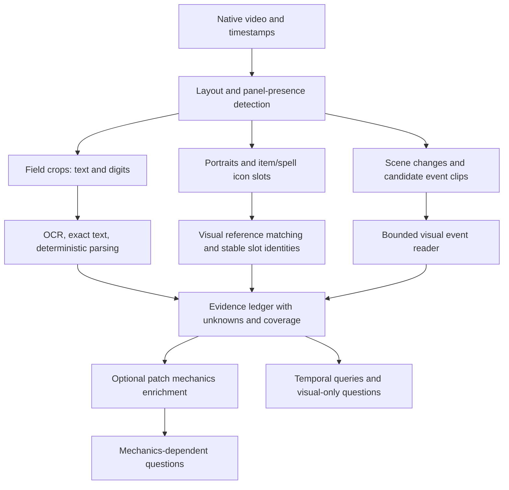

# League annotation: Longleaf diagnosis and intake redesign

Investigation date: 2026-10-21, America/New_York. This report concerns the actual
Longleaf run, not the earlier local preprocessing fixtures.

## Finding

The pilot fails through a combination of generation length, prompt-example copying,
unreliable component binding, and mismatches between the model's output and the
validator. Text recognition is uneven, but replacing the vision model or increasing
the output allowance alone would leave major failures intact. The current knowledge
formula gaps are not the direct cause of the recorded failures.

## What was inspected

- Authenticated SSH to `unc-cluster`, using the user's existing login and MFA.
- Repository: `/users/a/l/alshen/vgextract/vgextract`.
- Run: `data/league_runs/aatrox-26.13`; job `6125762`.
- Slurm accounting: **FAILED**, exit `1:0`, elapsed **01:14:42**, one NVIDIA L40.
- All **44 task records**, **142 generation completions**, input audits, available
  segment results, reference summary, run configuration, preflight, and job logs.
- Representative actual processed input images from source seconds 24 and 780,
  compared with native source imagery and the pipeline implementation.
- The remote code matches local prompt, knowledge, and validation code. Local
  generation-warning and task-logging edits were not in this job's remote code.
- No remote source files, results, or jobs were modified, and no GPU jobs were submitted.

The source SHA256 matches the local video:
`9352784b7d6e9faafc1b3ab57aad0f44849daeb0d64df3096a6cdb73b8994825`.
It is 1920×1080, 60 FPS, 1735.62195 seconds. Preflight records Python 3.12.15,
PyTorch 2.8.0, Transformers 4.57.1, CUDA 12.8, and BF16 on an L40.

Evidence was copied into the project's ignored data directory, preserving the
remote artifacts. The snapshot contains 712 files in a 4,489,062-byte compressed
archive. Counts are reproducibly summarized in
[analysis-summary.json](/Users/alex/Desktop/Projects/videogame/data/league_diagnosis/2026-10-21-longleaf/analysis-summary.json).

## 1. Current errors

### Pilot results

| Route | OK | Partial | Unresolved | Main observed problem |
|---|---:|---:|---:|---|
| Selected HUD | 2 | 2 | 0 | Identity handling; accepted output also confuses ability slots |
| Left sidebar | 0 | 4 | 0 | Null values marked visible, bindings, unresolved champion identities |
| Right sidebar | 0 | 4 | 0 | Same problems as left sidebar |
| Scoreboard | 0 | 0 | 4 | Output truncation; slot interpretation and invented inventories |
| Minimap | 4 | 0 | 0 | Two windows empty; two contain one observation with unknown entity |
| Match HUD | 0 | 4 | 0 | Numeric values violate exact displayed-text contract; team binding absent |
| Objective panel | 0 | 4 | 0 | Readable labels encoded with invalid entity names |
| Event feed | 3 | 1 | 0 | Empty output in three windows; invalid fields in the remaining window |
| Central notice | 0 | 4 | 0 | Prompt-example health values repeated in every call |
| Gameplay | 0 | 0 | 4 | Thinking consumes the complete output allowance |
| Full context | 0 | 0 | 4 | Same Thinking failure; substantial text-resolution loss |
| **Total** | **9** | **23** | **12** | |

The job stops at pilot acceptance, before full annotation or automatic review.
The failed routes are `scoreboard`, `gameplay`, and `full_context`.

### A. Truncation is real, but has two different causes

All eight Thinking calls generated exactly **8192 tokens**, took approximately
269–272 seconds each, and did not emit `</think>`. The pinned Thinking template
starts the assistant response inside `<think>`. Its tokenizer marks `</think>`
as a non-special token, so `skip_special_tokens=True` would preserve it if emitted.
The saved text remains an extended discussion of instructions, possible labels,
and guesses; the model never transitions to its final answer.

Each scoreboard window has one call that reaches **2048 tokens**. Here the model
is writing a dense answer about multiple rows and frames, rather than spending
the entire allowance in a Thinking block. Two windows retain successful earlier
segments before a later segment truncates.

These failures do not indicate input-context exhaustion. Thinking inputs contain
about 4.2–5.0K tokens, leaving input plus the 8192-token allowance well below the
configured 32768-token context. There are no recorded OOM completions. The highest
recorded PyTorch allocated memory is about 19.6 GB; that metric does not include
all reserved memory or prove that arbitrary larger contexts will fit.

The runner saves the raw text, rejects truncation before JSON parsing, and marks
the task unresolved. It has no bounded continuation, task splitting, or alternate
reader fallback. An unchanged retry uses the same settings and seed.

The Qwen Thinking model card lists a VL output setting of 40960 tokens, substantially
above this pipeline's 8192. That explains why a longer budget is an experiment worth
measuring, not evidence that it would fix grounding. Its sampling parameters match
the current Thinking call. The Instruct reader uses greedy decoding, whereas its
model card documents sampling; this also deserves an ablation rather than an
assumption that decoding choice caused all errors.
[Thinking model card](https://huggingface.co/Qwen/Qwen3-VL-8B-Thinking#generation-hyperparameters),
[Instruct model card](https://huggingface.co/Qwen/Qwen3-VL-8B-Instruct#generation-hyperparameters).

### B. The shared example is contaminating actual answers

The universal observer prompt includes a literal Aatrox health example:
`1326/2724`, confidence `0.9`, and a recall example in `top_lane`.

**All 16 central-notice calls repeat those health numbers.** At second 24, the
actual crop contains gameplay and champion nameplates, without a numeric health
panel. Health is not even an allowed field for this route. At second 780, the
model again emits those numbers plus an unsupported `channel` event. The validator
rejects these fields, leaving zero observations in all four central-notice tasks.

This is strong evidence of example copying. The Thinking responses also spend
time debating whether they should use the example's location or event. Enlarging
the output budget could simply allow more of that speculation.

### C. Many partial results are output-contract failures

Recorded issue occurrences, which are not independent error-rate measurements:

| Validation detail | Count |
|---|---:|
| Null value incorrectly marked visible | 715 |
| Missing or incorrect sidebar row binding | 172 |
| Entity is not a roster identity or typed world object | 165 |
| Gold/clock lacks exact displayed text | 63 |
| Field not allowed for route | 46 |
| Selected field has no grounded identity | 42 |

Examples from source second 780:

- **Match HUD:** the model reads the left kills as `17` and gold as `28500`,
  consistent with visible `17` and `28.5k`, but outputs `game_clock: 14.0` and
  numeric gold instead of preserving `14:00` and `28.5k`. It uses entity `unknown`
  and binding `selected` for a panel describing the match and two teams.
- **Objective panel:** it recognizes `Rift Herald`, 60 seconds, and `Cloud Drake`
  with `LIVE`. It emits entity `objective`, which the validator rejects; the
  contract expects a typed identity such as `objective:rift_herald`. Useful visual
  recognition is therefore erased during normalization.
- **Sidebars:** it recognizes several player names and levels, but emits many
  `null` fields under a shared `visibility: visible`. Champion identities remain
  unknown. The two sidebars retain 677 field observations, all with unknown entity,
  which the downstream fusion cannot promote to confirmed champion state.

Validation should remain strict. The remedy is to make the extraction contract
explicit and to preserve anonymous slot observations until identity resolution,
rather than broadly accepting malformed values or guessing their intended meaning.

### D. Some technically accepted output is factually wrong

At second 780, the selected-HUD output labels the leftmost passive countdown `15`
as **Q**, then treats small ability-rank numerals as other spell cooldowns. That
task is marked `ok` with confidence `0.9`. The input image is legible enough to
identify the component-placement error. This requires calibrated per-slot geometry.

The scoreboard output invents the same inventory `[3074, ..., 3081]` for multiple
visibly different rows. It labels a first-row trinket number `11` as champion level;
another row gets level `19`. The validator accepts arbitrary inventory lists and
does not establish that their icons match the pixels.

Of 1191 retained observations, 965 have unknown entity. Every retained confidence
is at least 0.9: 1129 are exactly 0.9, 36 are 0.98, and 26 are 0.99. No low-confidence
issue is recorded. These scores cannot currently act as calibrated uncertainty.

### E. `ok` can mean nearly empty

At seconds 24 and 780 the minimap returns empty observation/event/issue lists.
The other two windows return one observation each, with unknown entity. All four
tasks are marked `ok` despite the visible minimap containing substantial information.

Empty output can be correct for an event-feed crop when no event is present.
It needs a route-specific explicit absence result, while a persistent state panel
needs coverage requirements. Syntax acceptance is currently being used as a proxy
for successful intake.

### F. OCR resolution and task scope need separate treatment

Actual processed images are not missing or uniformly corrupted. The scoreboard
input is 896×320; sidebar inputs are 192×800; the selected HUD is 480×288.
These retain useful details. Gameplay is 1024×384 and full context is **576×320**.
The latter is useful for coarse context but discards much of the source HUD's text
detail. Scaling an already tiny source field up does not create missing evidence.

A local Tesseract spot check on five manually selected native-image field crops,
using only 4× scaling and a numeric-character whitelist, produced:

| Field | Visible reference | OCR output |
|---|---|---|
| Clock | `14:00` | `14:00` |
| Left team gold | `28.5k` | `28.5k` |
| First left KDA | `4/0/1` | `4/0/1` |
| First left CS | `115` | `115` |
| Selected health | `1326/2724` | `1326 2724` |

This is four exact strings out of five hand-picked fields in one frame, not an OCR
benchmark. It demonstrates a useful baseline and an actual delimiter error. It
does not establish Korean-name, icon, crowded-scene, or temporal-event accuracy.
[Probe inputs and results](/Users/alex/Desktop/Projects/videogame/data/league_diagnosis/2026-10-21-longleaf/ocr-probe/results.json).

## 2. Better information intake



### Stage 1: establish the layout and persistent slots

Detect the video layout and whether each panel or notice is actually present.
Calibrate precise subregions for clock, each team's kills/gold, each scoreboard
row, portrait, item slot, ability cooldown numeral, ability rank, and passive.
Keep the passive distinct from Q/W/E/R and distinguish bar fraction from numeric HP.

Assign stable slot identifiers independently of champion names. A row's visible
level or player name should survive even if champion identity is unresolved.
Resolve portraits against visual assets, then link scoreboard/sidebar/selected-HUD
slots using evidence and selection changes. Recheck the mapping after layout or
selection changes; do not assume continuous identity through a cut or occlusion.

### Stage 2: extract visible strings and simple visual states

Use language-appropriate OCR on individual text fields and lightweight detectors
for bars, item slots, and readiness/death indicators. Keep original pixels and
unmodified recognized strings, then derive typed values in code:

```json
{
  "frame_index": 0,
  "slot_id": "match:blue",
  "field": "displayed_gold",
  "raw_text": "28.5k",
  "parsed_value": 28500,
  "visibility": "visible",
  "source_box": [792, 12, 860, 46]
}
```

This is a proposed intermediate representation, not the current schema. Geometry
and frame identity should be attached by the caller, rather than generated as long
hash strings. Store OCR uncertainty and parse failure separately. When exact text
cannot be recovered, retain the unresolved crop instead of reconstructing a string
from a guessed number.

PaddleOCR is a candidate to benchmark alongside the installed Tesseract baseline:
its pipeline exposes recognized strings, text boxes, and recognition scores, and
its Korean recognizer supports Korean, English, and digits. Those capabilities do
not establish accuracy on this game's typography.
[Official OCR documentation](https://www.paddleocr.ai/main/en/version3.x/pipeline_usage/OCR.html).

### Stage 3: use visual matching for identities and icons

Item IDs are not printed on item icons. Resolve candidates through a patch-pinned
image-reference index or a trained visual matcher, with top alternatives and a
rejection threshold. Apply the same principle to champion portraits and spell
icons. Cache candidates and reuse unchanged slot appearances.

Data Dragon supplies static champion, item, spell, and passive assets. This is
useful reference material for visual identity resolution, separate from live match
state. Verify asset coverage for this recording, including transformations, skins,
overlays, and local layout conventions, before treating a nearest match as truth.
[Riot Data Dragon documentation](https://developer.riotgames.com/docs/lol#data-dragon).

### Stage 4: give each generative reader a small, explicit job

- Replace the universal answer example with route-specific schemas and examples
  that do not reuse facts from the target recording.
- Read a scoreboard row or field group from one frame, then extract changes.
  Do not ask for all ten rows, all item identities, and multiple snapshots in one
  response with a 2048-token cap.
- Use short frame indexes and slot IDs. Attach source hashes, timestamps, full
  evidence IDs, route ownership, and model provenance in code afterward.
- Keep allowed fields, visibility states, and entity types explicit per reader.
  A schema can constrain structure, but cannot prove that a value is visible.
- Benchmark a non-Thinking visual reader for basic extraction and bounded events.
  Reserve Thinking for ambiguity that benefits from reasoning, rather than every
  gameplay and full-context window.
- Add bounded failure recovery: split an oversized segment or use a narrower
  task once; stop with a diagnostic after the retry allowance is spent. Preserve
  all attempts and costs. Raising the output cap should be an isolated ablation.

### Stage 5: temporal intake should be driven by changes

Maintain a ledger of observed facts with their source time and evidence. Reuse
unchanged crops for computation, without turning absence of a new observation into
proof that state remained unchanged. Separate measured state, tracked hypotheses,
and mechanically derived values.

Use cheap frame differences, HUD transitions, and notice/panel presence to nominate
short event clips. Sample those clips more densely and ask event-specific questions.
The current 1-FPS discovery cannot reliably establish every short cast, hit, or
ward placement. Keep those limits explicit rather than assigning precise events
from sparse frames. The existing exclusion of unsupported fast events is useful.

## 3. Is the knowledge gap necessary?

### What happened in this run

All 173 champion details are cached, but each has a `partial` reference status.
For Aatrox, missing fields include formula substitutions such as `qdamage`,
`qedgedamage`, healing modifiers, and description appendices. This describes static
mechanics completeness; it does not mean the reference files failed to download.

There are 130 successful-call knowledge transcripts and **zero completed knowledge
lookups**. The 12 generation failures occur before a usable final answer or query.
The resolver was therefore not directly responsible for these recorded failures.
The full 173-champion roster and the lookup rules are nevertheless included in
every request, even for simple clock or notice extraction.

### Keep three distinct layers

| Layer | Needed for | Treatment |
|---|---|---|
| Visual identity reference | Matching portraits, item icons, spell icons, and names | Keep a small, indexed, patch-pinned asset layer |
| Observed match evidence | Displayed numbers, item-slot changes, positions, visible events | Must work independently of mechanics completeness |
| Mechanics enrichment | Ability effects, item stats, formulas, conditional cooldown expectations | Optional and requested after relevant observations exist |

Reading `14:00`, `28.5k`, a KDA, or a displayed cooldown does not require resolving
all champion formulas. Keep those pathways operational when mechanics references
are partial. Only questions that actually depend on an unresolved mechanic should
be ineligible or explicitly unresolved.

Even complete mechanics references do not reveal hidden match facts. A theoretical
cooldown needs the relevant rank, modifiers, haste, resets, and patch conditions;
it cannot substitute for unreadable pixels. Resolve semantic knowledge after
perception, and attach derived results with their assumptions and provenance.

The current patch pinning, static-only scope, and explicit unresolved variables are
good safeguards. Preserve them while removing the full mechanics-resolution loop
from routine OCR and panel intake.

## 4. What to change first, and how to test it

1. **Create a small labeled intake set before another full run.** Use the four
   existing pilot windows plus held-out times. Label component locations, exact
   strings, row identities, visible/absent fields, and a few actual events. Include
   empty notices, dead champions, cooldown/rank ambiguity, and Korean names.
2. **Fix prompt and schema contamination.** Remove target-video constants,
   specialize contracts by route, and require evidence for each requested field.
   Test blank/unrelated crops to measure copied examples and invented values.
3. **Calibrate slots and introduce field-level crops.** Start with clock, team
   kills/gold, KDA, CS, selected health, passive/ability ranks, and cooldown text.
   Compare OCR and VLM readers on the same original crops.
4. **Resolve identity separately.** Retain anonymous slot facts and benchmark
   portrait/item reference matching. Do not expand textual mechanics retrieval
   to compensate for unrecognized icon pixels.
5. **Replace the broad Thinking observer with a bounded event experiment.** Compare
   current Thinking, a concise route-specific Thinking prompt, and an Instruct
   event reader on identical short clips. Measure factuality, event recall,
   completion, runtime, and output length. A larger Thinking cap is only one arm.
6. **Make pilot acceptance reflect useful intake.** Track exact field accuracy,
   expected-field coverage, missing/absent correctness, identity/slot accuracy,
   out-of-schema rates, truncations, and time per field/clip. An empty minimap
   answer must not pass the same gate as a successful state read.
7. **Preserve stage independence.** A mechanics gap should not invalidate raw OCR.
   A generation-setting change should not force re-decoding or re-running unrelated
   extraction. The current fingerprint couples the annotation configuration and
   implementation broadly, so changes can invalidate more work than intended.

For evaluation, keep a manually verified subset distinct from model-generated
provisional labels. The existing reporting split between verified and unreviewed
references is useful; a second Qwen pass can share the first pass's mistakes and
cannot by itself establish truth.

## Limits of this diagnosis

This investigation establishes the current run's failure modes and inspects actual
pixels and completions. It does not establish a replacement model's general OCR
accuracy, calibrated icon matching, event quality, or throughput. No redesigned
GPU reader was benchmarked. The proposed decomposition should be tested on a
small held-out intake set before another complete-game allocation.
