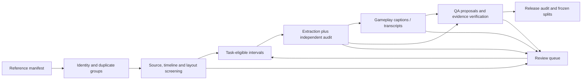

# Quality evaluation plan for the video annotation pipeline

Draft v0.1 · 2026-11-02 · Planning specification, not an implemented or validated quality service.

## Recommendation

Use **task-specific gates plus a quality profile**, rather than one weighted quality score. Evaluate four separate outputs:

1. **Data quality:** source integrity, task observability, extracted observations, and collection design. This is the first implementation priority.
2. **Gameplay-caption quality:** whether generated descriptions accurately represent visible gameplay.
3. **Transcript/subtitle quality:** whether text accurately represents the speech and its timing. Score this separately from gameplay captions.
4. **QA-generation quality:** whether a question has a justified answer from the exact evidence supplied to the solver.

A high-quality recording can yield bad annotations. A correct transcript can faithfully reproduce an incorrect commentator statement. A well-written question can have an unsupported answer. Keep these judgments separate and preserve their dependencies.

The initial application is longitudinal observation of one League pro across multiple unique matches, aggregating commentary and clean replays. The same framework can support other games through game-specific evidence and layout adapters. Current work remains **reference links only: this plan authorizes no video downloads or inference jobs**.

## 1. Units and decisions

### Units to track

| Unit | Why it needs its own identity |
|---|---|
| Upload/source version | A commentary upload and a clean replay can depict the same match. URLs and metadata can change or disappear. |
| Underlying match | The unit for game counts, deduplication and split assignment. Retain a candidate match group when identity is unresolved. |
| Player appearance | Bind the studied pro to a verified account/actor in this match; distinguish the selected HUD actor and camera subject. |
| Timeline/layout/view span | A cut, rewind, slide, POV change or moved facecam changes what can be inferred. |
| Task-eligible interval | HP tracking, movement analysis and speech transcription can have different usable intervals. |
| Observation/event | Store field value, actor, source time, availability and supporting evidence. |
| Caption/transcript/QA item | Each output points to its source spans and upstream versions. |
| Dataset release | Freeze inclusion, exclusions, identities, splits, labels and policies. |

Use source presentation time as the primary time axis. Store a piecewise mapping to displayed game time; game time alone is not a unique timestamp. A review can show the same game instant repeatedly.

### Decision states

- `accept_for_task`: required gates passed for a named task, scope and evaluated profile.
- `restrict`: an explicit subset of intervals, fields or claims is usable; other capabilities are disabled.
- `review`: required evidence is missing, conflicting or not yet independently checked.
- `reject_for_task`: a confirmed failure makes this scope unsuitable for this task. This does not reject every other use of the video.

Individual gates use `pass`, `fail`, `unknown` or `not_applicable`. Unknown required gates cannot produce acceptance. A restriction is not an exception to a failed gate: it creates a smaller eligible scope and re-evaluates its requirements.

For dimension ratings use this common scale, with the dimension-specific anchors below:

| Rating | Meaning |
|---|---|
| 0 | Confirmed defect invalidates the intended task in this scope. |
| 1 | Material limitations; substantial exclusion or repair is required. |
| 2 | Usable with explicit, bounded restrictions. |
| 3 | Meets the declared task requirements on the assessed scope, with supporting evidence. |
| null | Not assessed/insufficient evidence; record `unknown` or `not_applicable` separately. |

Ratings summarize review; they are **ordinal, not confidence probabilities**, and must not be averaged to override a gate. “3” on sampled spans does not certify unseen parts of the upload.

## 2. Data-quality rubric — first priority

### A. Source and evidence availability

| Dimension | 0: invalid | 1: limited | 2: restricted use | 3: meets task contract | Automation and human responsibility |
|---|---|---|---|---|---|
| D1. Provenance and reproducibility | Evidence comes from a different/untraceable source | URL exists but version/time references are ambiguous | Pinned URL, metadata snapshot and evidence links; exact media identity unavailable | Source/version and all derived artifacts reproducible under the declared access mode | Automate manifest completeness and link checks. Exact-byte hashes require authorized media access; a URL alone is not a byte identity. |
| D2. Match and player identity | Wrong actor/match assigned | Title or commentator mention is the only identity evidence | Account/roster evidence supports a candidate identity; unresolved items excluded from confirmed-pro analysis | Target actor and match verified with recorded evidence; duplicate uploads grouped | Metadata/roster/name similarity proposes candidates. A reviewer resolves account identity and uncertain match groups. |
| D3. Visual legibility | Required evidence cannot be read | Frequent blur, nested footage or occlusion prevents the task | Specific fields/intervals remain readable and are retained | Required regions are readable at actual extraction **and solver-input** resolution | Automate geometry, crop occupancy and blur/occlusion diagnostics. Review effective detail and representative hard cases. Nominal 1080p is not proof. |
| D4. Timeline integrity | Events counted across unhandled rewinds/cuts | Gaps/repeats/speed changes are unlocalized | Valid monotonic spans isolated; cross-gap claims disabled | Source/game mapping and repeat handling meet the task's temporal resolution | Clock, PTS, shot and similarity checks flag boundaries. Review uncertain boundaries; clock OCR alone cannot establish continuity. |
| D5. Layout and actor binding | HUD/camera observations assigned to the wrong actor | Profile or actor selection is often uncertain | Stable, calibrated spans retained; ambiguous selections excluded | All required fields bound to the right actor within validated layout spans | Anchor/layout and roster checks flag drift. Reviewer verifies new layouts and binding; channel name is not a layout profile. |
| D6. Task observability and completeness | Task requires evidence absent from the source | Only isolated moments or incomplete action chains exist | Partial-game/field capabilities declared with eligible intervals | Required setup, action and result, or required state/time coverage, are observable | Automate interval accounting. Humans establish whether evidence supports the intended claim. Long runtime does not prove full-match coverage. |
| D7. Audio availability and intelligibility | Required speech unavailable/unintelligible | Frequent masking, overlap or missing speech | Usable language/speaker spans isolated | Speech usable for the declared transcription task across assessed spans | Channel/language/VAD diagnostics triage. Human listening establishes intelligibility. N/A for visual-only tasks; muted browser playback does not grade audio. |

### B. Extracted observations

| Dimension | 0: invalid | 1: limited | 2: restricted use | 3: meets task contract | Automation and human responsibility |
|---|---|---|---|---|---|
| D8. Field/event accuracy and coverage | Wrong values/events make task answers unreliable | Quality is below target in important slices | Validated field/layout slices retained, others disabled | Independently labeled held-out precision **and** coverage meet the declared targets | Automated scoring against human references; label creation/adjudication remains independent of predictions. Event models require event references, not just OCR references. |
| D9. Time alignment, freshness and consistency | Stale state or bad ordering changes the answer | Freshness/uncertainty not reliably propagated | Only time-local observations or validated propagation retained | Timing tolerances, expiration, continuity and actor constraints validated | Deterministic checks catch impossible ordering, expired values and span crossings. They flag contradictions; they do not prove semantic truth. |
| D10. Traceability and uncertainty | Derived claims lack source evidence or invent hidden state | Evidence links/unknowns inconsistently retained | Unsupported outputs excluded; residual gaps explicit | Every accepted output has evidence, versions, epistemic status and review provenance | Automate lineage/schema checks and invalidation. Human review distinguishes visible facts, speech claims and inference. Model confidence is not verified accuracy. |

### C. Collection quality for longitudinal studies

| Dimension | 0: invalid | 1: limited | 2: restricted use | 3: meets study contract | Automation and human responsibility |
|---|---|---|---|---|---|
| D11. Independent games and sampling coverage | Reuploads/repeated views counted as independent games | Few verified games, narrow contexts or unknown omissions | Bounded case study with explicit selection bias and denominators | Predeclared game/context coverage achieved; duplicates and observation gaps accounted for | Automate counts and distributions by match, date, champion, role, patch, outcome and source. Reviewer evaluates whether claims match sampling. |
| D12. Split integrity and cohort comparability | Same-match evidence/answers cross evaluation splits | Duplicate families or incompatible contexts unresolved | Uncertain groups quarantined; separate cohorts used | Match families grouped, study-appropriate split frozen, patch/mode/source differences documented | Automate group overlap and lineage checks. Reviewer chooses the study design and resolves uncertain groups. |

“Pro commentary” is a sourcing preference, not a quality score. Keep P1/P2/P3 independent of D1–D12. A P2 source can supply clearer visual evidence than P1; a commentator's claim cannot repair missing visual evidence for a visual-only benchmark.

### Task contracts and hard gates

Specify required evidence **before** scoring. Start with these contracts:

| Task | Required gates | Allowed restrictions |
|---|---|---|
| Slow visible-state QA | Source/time traceability; calibrated layout; readable required fields; actor binding; validated field reader; solver-visible evidence | Disable masked fields and bad layout spans; no inferred hidden state |
| Exact action/order QA | Above, plus native/dense temporal evidence, complete event chain, validated action/event labels and timing tolerance | Reject exact-order claims when sampling skips decisive frames; slow-state acceptance does not transfer |
| Longitudinal observed behavior | Verified target identity; unique-match grouping; known eligible observation intervals; comparable cohorts; validated underlying labels | Partial-game analysis allowed if explicitly scoped; report behavior conditional on observed opportunities |
| Speech transcription | Accessible intelligible speech, appropriate language coverage and source timestamps | Exclude unusable audio spans; do not gate visual tasks on audio |
| Patch-dependent mechanics | Established patch, patch-matched static references and sufficient visible state | Unknown patch disables mechanics claims but can leave visual-only tasks eligible |

Confirmed wrong actor, unsupported answer-critical evidence, unresolved continuity needed by a cumulative task, or same-match split leakage are blocking failures at the relevant scope. Missing verification is `review`, not a fabricated pass or automatic rejection.

The existing primary League intake prefers at least 1080p. Keep that collection policy for now, while measuring actual readability. Do not turn it into a universal claim that 720p is unusable or 60 fps is necessary for every task.

## 3. Metrics and denominators

Report counts alongside rates, both overall and by field, layout, phase, source and difficulty. Use independent reference labels to define readability; the extractor cannot remove difficult cases from its own denominator.

| Measure | Definition | Failure it exposes |
|---|---|---|
| Accepted-value precision | Correct accepted predictions / all accepted predictions in the labeled sample, including false values on absent/unreadable evidence | Confidently wrong readings; accepting more values cannot hide errors |
| Readable-field coverage | Readable reference cases with an accepted value / all readable reference cases | Excessive abstention; unknowns and missing predictions lower coverage |
| Supported yield | Correct accepted predictions on readable cases / all readable reference cases | Usable correct output, complementing precision and coverage |
| Availability quality | Confusion matrix for visible/readable, absent, unreadable and unknown; false-visible and false-absent rates | Mistaking hidden HUD for zero, or discarding readable evidence |
| Actor binding accuracy | Correct bindings / independently reviewed binding decisions; separately report unresolved fraction | Correct numbers attributed to the wrong player |
| Event precision / recall | Matched predictions / predictions; matched references / references, with fixed actor/type/time matching | Hallucinated or missed events; recall requires an independent event inventory |
| Temporal error | Absolute onset/offset error, p50/p95 and tolerance pass rate; interval overlap where meaningful | Incorrect timestamps and event ordering |
| Observable coverage | Union of eligible **game-time** intervals / known relevant match interval; separately report source-time viewing and target-visible time | Long commentary videos mistaken for full observed matches |
| Unique-match yield | Confirmed distinct eligible matches / candidate uploads screened; unresolved groups separate | Reuploads inflating longitudinal sample size |
| Lineage/split defects | Missing-evidence items, stale dependents and cross-split match groups, with raw counts | Unreproducible artifacts and evaluation leakage |

If match duration is unknown, report observable minutes and “denominator unknown”; do not invent a full-match percentage. Union overlapping evidence from multiple uploads of one match rather than adding their durations. Align sources explicitly; one video's timestamp is not transferable to another upload. Clean replay evidence may corroborate references, but an item is answerable only if its **allowed solver input** contains the required evidence.

For behavior frequencies, use task-eligible observed opportunities, not all actual opportunities in the match. “Three observed roams across six observable lane phases” is supported; a population roaming rate from highlight-selected videos is not. Report games and players contributing to each estimate, not just frame counts.

### Existing targets versus proposed policy

The current League intake benchmark already has these enabled-family targets:

| Family | Precision target | Readable coverage target |
|---|---:|---:|
| Numbers, exact transcription | 99% | 90% |
| Text | 95% | 70% |
| HP bars, within 5 percentage points | 95% | 90% |
| Presence/availability decision | 99% | 95% |

These are **existing point-estimate gates**, not evidence that production has achieved them. Numeric parsed accuracy is reported separately from exact transcription. Deferred icon/action capabilities must not inherit acceptance from these families. See [intake benchmark](../annotation/league/intake_benchmark.py) and [pipeline status](../annotation/league/README.md).

The current 20-development/20-held-out-frame intake design is a useful smoke/calibration check. It cannot establish 99% general accuracy across new games/layouts. Add more independent games and report uncertainty before making strong accuracy claims. Nearby frames are correlated; confidence intervals should resample at match level (with source/layout strata where practical), and sparse strata should remain explicitly uncertain. Do not treat thousands of crops from one match as thousands of independent games.

New behavioral, caption and QA thresholds remain **to be calibrated**. Record task-specific error tolerances and minimum evidence counts before opening held-out labels. Require zero known unresolved answer-critical defects in released items, while reporting the audit's statistical limits; zero observed defects does not prove zero remaining defects.

## 4. Applicable pipeline and automation boundary



| Stage | Automated work | Human work / exit artifact |
|---|---|---|
| 0. Declare task and access mode | Validate task contract, capabilities, source links and policy versions | Choose player/cohort and permitted modalities. Output: manifest; unavailable checks remain pending under reference-only access. |
| 1. Group evidence | Candidate duplicate matching from IDs, rosters, clocks and visual signatures when available | Confirm player account and match groups. Output: verified/candidate identities and duplicate-family IDs. |
| 2. Preflight | Metadata/geometry checks; authorized-media PTS/decode checks; sampled layout, clock and quality diagnostics | Review opening/middle/ending, every novel layout and flagged boundary. Output: provisional spans and capability masks, not whole-video certification. |
| 3. Calibrate and benchmark | Run extraction, score independent labels, freeze development settings, then score untouched holdout | Label source evidence independently, adjudicate hard cases. Output: per-slice metrics, failures, uncertainty and profile version. |
| 4. Process eligible evidence | Apply frozen profile; retain unknowns; split at discontinuities; detect drift; retain evidence and versions | Review new drift/failure classes. Output: observations and events admitted only for validated capabilities. |
| 5. Evaluate generated outputs | Claim/evidence checks, transcript metrics and QA validators; models may prioritize suspicious items | Independent reference review, critical-error adjudication and answer verification. Output: separate quality reports for each artifact type. |
| 6. Release and monitor | Match-group split checks; dependency freshness; sampled audit; compare distributions to calibration cohort | Approve scoped release and exclusions. Output: dataset card, fixed manifest/splits, audit results and unresolved limitations. |

**Feasible now:** deterministic contracts, provenance, interval arithmetic, schema checks, metric calculation, split checks and review scheduling. **Needs calibration:** automatic blur/occlusion/layout/cut detection, cross-upload match matching, claim judges and confidence thresholds. **Retains human adjudication:** ambiguous identity, new layouts, source-level truth, unsupported inference and final benchmark answer keys. Detector/model agreement is a diagnostic, not independent ground truth.

QA can be proposed directly from validated observations; captions are optional assistance, not a required intermediate or an independent answer verifier.

Media-dependent checks are future steps for an authorized processing run. The immediate reference-only version can store timestamped links, metadata, observed format limitations, identity evidence and pending checks without downloading anything.

### Sampling and review design

Maintain two queues and report them separately:

1. **Random audit:** sample games and eligible/quiet windows independently of model triggers. This estimates ordinary defect prevalence and finds missed events.
2. **Targeted review:** oversample low-confidence outputs, layout changes, rewinds, occlusions, rapid action, unknowns and contradictions. This diagnoses failures; its error rate is not the collection-wide error rate.

For a first calibration batch, propose **10 verified unique matches of one player**, ideally spanning at least two sources and two layouts when available. This is an engineering pilot, not a sufficient statistical sample for broad claims. Keep all versions of a match together. Use six matches for development and four as a frozen pilot holdout; collect additional games for subsequent release evaluation rather than repeatedly tuning on that holdout. Annotators working on holdout references must not see model predictions before labeling.

Per source, start with five dispersed one-minute windows plus explicit beginning/end checks; add random quiet windows and all detected layout/continuity changes. This adapts the existing League pilot, but sampled preflight alone cannot authorize whole-game cumulative claims. Such claims require validated interval coverage and review of unresolved gaps. Include absent, unreadable and off-target cases as well as clear positives.

Double-label 20% of pilot audit units and all answer-critical disagreements; adjudicate with source evidence. Measure agreement by field/claim category and revise ambiguous instructions. These sample counts and the double-label percentage are **proposed starting budgets**, not calibrated acceptance thresholds. After calibration, set ongoing random-audit size from observed defect rates and the error bound the study needs. New layouts and distribution drift return to calibration rather than inheriting a channel-wide pass.

Choose evaluation splits to match the research question. For **future behavior of the same player**, use chronologically held-out match families and record patch/champion/context changes; do not claim unseen-player generalization. For **generalization to new players**, hold players out as well as their matches. For comparing habits over time, define calendar periods and comparable contexts before counting events. Ten games are a pipeline pilot, not a universal minimum for a long-term behavioral conclusion; required games and time horizon depend on the behavior's frequency, variation and observation coverage.

### Review record and invalidation

Each decision should carry:

```json
{
  "rubric_version": "0.1.0-draft",
  "source_id": "example-upload",
  "source_url": "https://www.youtube.com/watch?v=EXAMPLE",
  "access_mode": "reference_only",
  "match_group_id": "candidate-match-001",
  "identity_status": "candidate",
  "task": "visible_state_qa",
  "scope": {"kind": "source", "source_time_intervals_s": null},
  "decision": "review",
  "required_checks": [
    {"id": "identity", "status": "unknown", "reason": "identity_unverified"},
    {"id": "reader_validation", "status": "unknown", "reason": "reader_unvalidated"}
  ],
  "metrics": [],
  "evidence_refs": [],
  "reviewer": null,
  "upstream_versions": {},
  "limitations": ["Illustrative record; no source inspection or metrics implied."]
}
```

Actual records add match/player evidence, layout profile and span IDs, eligible intervals, metric numerators/denominators, reference-set version, reviewer/adjudication status, model/prompt/config versions, metadata snapshot date and hashes where available. Never fabricate measurements to fill mandatory fields: mark the check pending.

Store dependency links so a changed actor binding, timeline, crop profile, reference label or source version invalidates affected observations, captions, answers and cached scores. Re-evaluate affected dependents before release. Make review corrections versioned rather than silently overwriting evidence.

The companion [machine-readable draft rubric](quality/data-quality-rubric.v0.1.json) provides dimension IDs, task contracts, states and existing targets. It is configuration for a future evaluator, **not an executable gate engine or proof that these checks ran**.

## 5. Gameplay-caption rubric — outline

Evaluate generated visual descriptions independently of transcript fidelity. Split each caption into checkable actor/action/target/state/outcome/time claims. Label each claim `supported`, `contradicted`, `unsupported` or `ambiguous` against the permitted source evidence; only supported claims count as grounded.

| Criterion | Suggested measure | Gate principle |
|---|---|---|
| Factual grounding | Supported claims / all assessable claims; separately report ambiguous fraction and captions with critical defects | Wrong actor, invented event, wrong outcome or false causal claim blocks the affected caption |
| Salient coverage | Covered reference events / independent salient-event inventory, with salience rules fixed in advance | Do not reward safe but empty captions; the model's own event list cannot define recall |
| Temporal fidelity | Correct event order, onset/offset error and required setup/action/result coverage | Captions cannot move events across cuts, repeats or actors |
| Uncertainty and scope | Unsupported hidden-state/intent/mechanics claims; appropriate unknowns | Distinguish observation from interpretation and attributed commentary |
| Readability and utility | Human 0–3 clarity/redundancy score with examples | Fluent text cannot compensate for factual defects |

An atomic claim is assessable when source review can classify its support; ambiguous claims remain visible in the report rather than disappearing from the denominator. Also report supported claims / **all** claims as a conservative grounded yield. State critical-error counts separately instead of hiding severity in arbitrary weights.

Use an independently reviewed event/claim set for a small calibration benchmark. A model can propose claim splits and flag mismatches, but human source review supplies the reference and calibrates judge errors. Text-similarity scores are optional diagnostics, not grounding gates: the CHAIR research demonstrates why text similarity can miss object hallucination. Its image/object metric is **not** a validated gameplay-action metric; the claim-based adaptation here needs its own validation. [Object Hallucination in Image Captioning](https://aclanthology.org/D18-1437/)

Commentary-assisted captions must declare that modality and attribute statements such as “the commentator says…”. For visual-only evaluation, commentary cannot establish an unseen kill, intention or resource value.

## 6. Transcript/subtitle rubric — separate outline

The target is **what was spoken**, even when the speaker's gameplay analysis is wrong. Platform auto-captions are candidate transcripts, not independent references for evaluating ASR.

| Criterion | Suggested measure | Important control |
|---|---|---|
| Lexical fidelity | WER = (substitutions + deletions + insertions) / reference words; CER where appropriate | Fix normalization and language policy; retain a strict score alongside any normalized score |
| Domain-critical fidelity | Name/champion/item accuracy; number and negation errors; entity precision and recall | A low overall WER can hide changed player identities or reversed meaning |
| Timing | Word/segment onset and offset error, p50/p95, tolerance pass rate | Source time, not game time; in-bounds timestamps alone do not establish accurate alignment |
| Speech coverage and hallucination | Missed speech duration; false words during independently labeled nonspeech | Evaluate silence/music separately, not through WER with a zero-word denominator |
| Speaker/language handling | Speaker attribution, overlapping-speech and code-switching slices | Mark unresolved speech instead of inventing text |
| Subtitle presentation | Reading speed, line breaks, synchronization and completeness | This is an additional presentation score when generating display subtitles |

Build short independently transcribed/word-aligned references stratified by clean speech, fight audio, overlap, accents, code-switching and game terminology. Blind initial transcription to ASR output. Evaluate timestamp quality on reference word matches and report unmatched words separately. WER follows the standard ASR definition; corpus and normalization differences affect comparability. [NIST ASR metrics](https://trec.nist.gov/pubs/trec9/sdrt9_slides/tsld017.htm)

Do not combine gameplay-caption grounding and ASR WER into one caption-quality score. They have different references, denominators and failure consequences.

## 7. QA-generation rubric — outline

| Criterion | Review question / automated assistance | Gate principle |
|---|---|---|
| Answerability | Does the actual solver-visible video/window contain sufficient evidence? Check time, resolution, actors and allowed modalities | Unsupported positive questions are rejected or rewritten; intentional unanswerables form a separately tagged set |
| Answer-key correctness | Can an independent reviewer derive the key and accepted alternatives from source evidence? | Generated captions/observations may propose the key, but cannot certify it |
| Question clarity | Are actor, time scope, terms, units and requested granularity unambiguous? | Multiple defensible answers require alternatives or revision |
| Evidence and temporal validity | Does the question require only validated capabilities? Are counts bounded by eligible uninterrupted evidence? | No cross-gap cumulative counts or exact combos from sparse frames |
| Reasoning/task validity | Does the item test the intended retrieval, memory or comparison skill? | A longitudinal question must actually need evidence from multiple eligible moments/games; test by withholding required windows |
| Leakage and shortcut resistance | Are answers exposed by titles, transcript hints, filenames, annotations, UI artifacts or duplicate splits? | Audit the exact prompt payload; hold answer keys and construction logs outside solver input |
| Diversity and calibration | Distribution by task, actor, time span, answer and evidence difficulty; duplicate/paraphrase rate | Question count is not independent evidence count; keep templates from dominating |

For an initial benchmark, independently verify every released answer key; automate candidate construction and rejection checks first. Solver success does not validate a question and solver failure does not prove it invalid. After the process is calibrated, consider sampled review for lower-risk training material, with measured verifier precision and ongoing audits; keep benchmark keys independently verified.

For intentionally unanswerable items, the reference is an explicit abstention supported by the defined evidence boundary. This adapts the answerability principle of SQuAD 2.0; its text results do not validate a video verifier. [Know What You Don't Know](https://arxiv.org/abs/1806.03822)

## 8. Applying the plan to the existing League collection

These are **illustrations based on sparse format screening, not measured rubric passes**:

- Shok's Akali sample has facecam masking of the selected-unit panel: candidate for retained visible-field tasks, with HP/stat questions disabled until applicable spans are verified.
- Doxa commentary and its candidate LOLREC clean replay belong in one potential match family pending confirmation. They could provide complementary evidence, but must not become two independent matches or cross splits.
- LS's sampled historical review needs rewind segmentation and a separate historical cohort. Unknown patch can preserve visual-only use while blocking mechanics claims.
- Hidon/Bonks+ early-game material can support observed laning case studies. It cannot establish full-match behavioral frequencies merely because the upload is long.

Evidence and limitations: [format audit](research/league-video-format-audit-2026-11-02/README.md). The audit did not benchmark ASR, model extraction, full-video continuity or pro-account identity.

The League pipeline already supplies useful hooks: source preparation, crop/layout previews, versioned observations, intake benchmarking, a five-window cold pilot, timeline segmentation, review tools and separate human-verified versus unreviewed evaluation. Build the quality record around these artifacts. Do not replace them with a new model's overall “quality” rating. Current action/audio experiments need their own independent acceptance evidence before enabling corresponding tasks. See [League pipeline](../annotation/league/README.md), [validation status](../annotation/league/VALIDATION.md) and [question construction design](lol-question-construction-design.md).

## 9. Implementation sequence and deliverables

1. **Data-quality MVP:** implement the manifest/quality-record contract, reference-only review form, match grouping, capability masks and a reason-coded review queue. Manually label a calibration batch using D1–D12. Deliver a per-source and per-match report with eligible minutes and pending checks.
2. **Extraction acceptance:** adapt existing intake reports to the quality record; add held-out match-level slices, availability confusion matrices and uncertainty. Freeze profiles and dependency versions. Exit when declared tasks meet their evidence and accuracy contracts; otherwise restrict capability or gather more labels.
3. **Caption/ASR pilots:** create separate visual-claim and human-transcript references. Calibrate automatic judges/metrics against them before setting thresholds. Deliver two scorecards, not a shared score.
4. **QA verification and release:** enforce solver-input evidence checks, independently review keys, freeze match-group splits and publish a dataset card with audit limits. Automate subsequent drift alerts and affected-artifact invalidation.

The dataset card should state purpose, composition, collection method, exclusions, intended uses and limitations, following the documentation approach in [Datasheets for Datasets](https://arxiv.org/abs/1803.09010). Include the distinction between observed behavior in this selected collection and representative behavior across a player's entire match history.

The first useful deliverable is therefore an **audited eligibility table for unique matches of one player**, not a universal quality number or a large unverified caption/QA batch.
